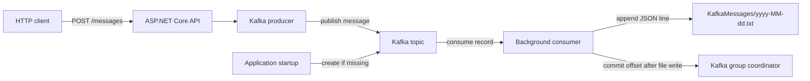

# KafkaPractice

A .NET 10 minimal API that publishes messages to Apache Kafka and consumes them into date-based text files.

## Solution structure

```text
KafkaPractice/
├── KafkaPractice.sln
├── src/
│   └── KafkaPractice.Api/
│       ├── Configuration/       # Kafka settings
│       ├── Endpoints/           # HTTP API routes
│       ├── Kafka/               # Producer, consumer, topic setup, file writer
│       ├── Properties/          # Local launch profiles
│       ├── KafkaPractice.http   # Example producer request
│       └── Program.cs           # Application composition and startup
└── tests/
    └── KafkaPractice.Tests/     # Unit and HTTP integration tests
```

## Requirements

- .NET 10 SDK
- An Apache Kafka broker reachable from this machine
- The broker address configured in `appsettings.json` (default: `localhost:9092`)

Check that a broker is listening before starting the application:

```powershell
Test-NetConnection localhost -Port 9092
```

The result should show `TcpTestSucceeded: True`. Start Kafka separately using your preferred local installation or Kafka development setup.

## Configure and run

From the solution root:

```powershell
cd "C:\DotNet Programe\KafkaPractice\KafkaPractice"
```

Check `Kafka` settings in `src\KafkaPractice.Api\appsettings.json`:

| Setting | Default | Description |
|---|---|---|
| `BootstrapServers` | `localhost:9092` | Kafka broker address |
| `Topic` | `practice-messages` | Topic used by the producer and consumer |
| `ConsumerGroupId` | `kafka-practice-consumer` | Consumer group name |
| `MessageOutputDirectory` | `KafkaMessages` | Output directory, relative to the project directory |

Restore dependencies and start the API:

```powershell
dotnet restore KafkaPractice.sln
dotnet run --project src\KafkaPractice.Api\KafkaPractice.Api.csproj
```

The HTTP launch profile listens at `http://localhost:5282`. At startup, the app connects to Kafka and creates the configured topic if it does not already exist. Check the console for `Created Kafka topic` or `Kafka topic ... already exists`, followed by `Consuming messages`.

If Kafka is hosted at a different address, update `BootstrapServers` or override it for this run:

```powershell
$env:Kafka__BootstrapServers = "127.0.0.1:9092"
dotnet run --project src\KafkaPractice.Api\KafkaPractice.Api.csproj
```

## Send a message

The `POST /messages` endpoint publishes a message to the configured topic. Send a request from PowerShell:

```powershell
$body = @{
    message = "Hello from the Kafka producer"
    key = "sample-key"
} | ConvertTo-Json

Invoke-RestMethod `
    -Uri "http://localhost:5282/messages" `
    -Method Post `
    -ContentType "application/json" `
    -Body $body
```

The `key` is optional; when omitted, the producer assigns a unique key. A successful response includes the topic, partition, offset, and key. An empty message returns `400 Bad Request`. The same sample request is available in `src\KafkaPractice.Api\KafkaPractice.http`.

## Consume and save messages

The consumer runs in the API process as a hosted background service; no separate consumer command is needed. It subscribes to the configured topic and, for each record, appends one JSON object per line to:

```text
src/KafkaPractice.Api/KafkaMessages/yyyy-MM-dd.txt
```

The date is the UTC date when the app received the message. Each JSON line contains `ReceivedAtUtc`, `Key`, `Value`, `Topic`, `Partition`, and `Offset`. For example:

```json
{"ReceivedAtUtc":"2026-11-07T20:26:28.2340289+00:00","Key":"sample-key","Value":"Hello from the Kafka producer","Topic":"practice-messages","Partition":0,"Offset":0}
```

After a record is appended successfully, its Kafka offset is committed. The console logs each saved message and the output file path.

## Run tests and verify coverage

Run all unit and in-process HTTP integration tests from the solution root:

```powershell
dotnet test KafkaPractice.sln
```

Measure coverage and enforce **100% line and branch (condition) coverage** for the application assembly:

```powershell
dotnet test tests\KafkaPractice.Tests\KafkaPractice.Tests.csproj `
    /p:CollectCoverage=true `
    /p:CoverletOutputFormat=cobertura `
    /p:CoverletOutput=TestResults\coverage\
```

The test project sets both coverage thresholds to 100%; the command fails if either threshold is missed. Generated files under `obj` are excluded. The Cobertura report is written to `tests\KafkaPractice.Tests\TestResults\coverage\coverage.cobertura.xml`. Kafka interactions are isolated behind test doubles, so the automated tests do not require a running broker.

## Workflow



## Troubleshooting

- **Cannot connect to Kafka:** Start the broker and ensure its address matches `Kafka:BootstrapServers`. On Windows, `localhost` may resolve to IPv6; if the broker only listens on IPv4, use `127.0.0.1:9092` in the setting.
- **Topic creation fails:** Confirm the broker is reachable and the configured client has permission to create topics.
- **No output file appears:** Confirm the app is still running, check its console for consumer or file-write errors, and verify that the producer received a successful response.
- **Messages are not consumed:** Confirm the producer and consumer use the same topic and broker address.
